<!-- Stick: kostenlose Software für Strichmännchen-Animation -->
<p align="center">
  <a href="https://blixvip.github.io/stick/#tour">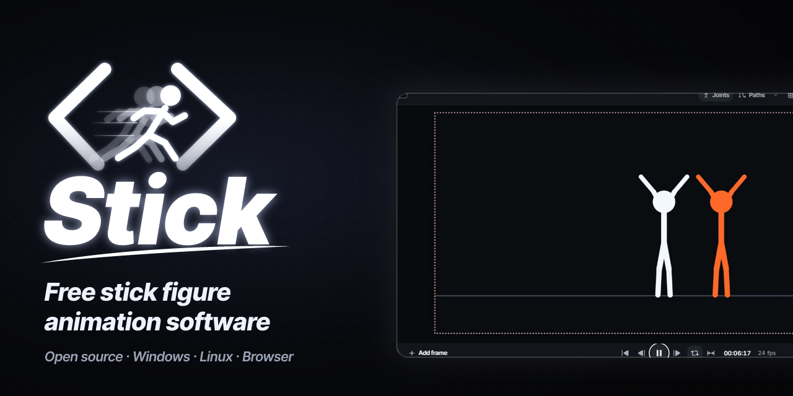</a>
</p>

<h1 align="center">Stick: kostenlose Software für Strichmännchen-Animation</h1>

<p align="center">
  <b>Posen. Keyframes setzen. Zeichnen. Exportieren.</b><br>Stick ist ein kostenloser Open-Source-Animator für Strichmännchen unter Windows, Linux und im Browser.<br>Erstelle Stickman-Kämpfe, Laufzyklen, Memes und Kurzfilme und exportiere als MP4, GIF oder PNG.
</p>

<p align="center">
  <a href="https://github.com/blixvip/stick/stargazers"></a>
  <a href="../../LICENSE"></a>
  
</p>

<p align="center">
  <a href="https://blixvip.github.io/stick/#tour"><b>▶ 2-Minuten-Tour ansehen</b></a> ·
  <a href="#stick-holen">Stick holen</a> ·
  <a href="#funktionen">Funktionen</a> ·
  <a href="#galerie">Galerie</a> ·
  <a href="#faq">FAQ</a> ·
  <a href="#aus-dem-quellcode-bauen">Aus dem Quellcode bauen</a>
</p>

<p align="center">
  <a href="../../README.md">English</a> ·
  <a href="README.zh-CN.md">简体中文</a> ·
  <a href="README.zh-TW.md">繁體中文</a> ·
  <a href="README.ja.md">日本語</a> ·
  <a href="README.ko.md">한국어</a> ·
  <a href="README.es.md">Español</a> ·
  <a href="README.pt-BR.md">Português</a> ·
  <a href="README.fr.md">Français</a> ·
  <b>Deutsch</b> ·
  <a href="README.ru.md">Русский</a>
</p>

<p align="center">
  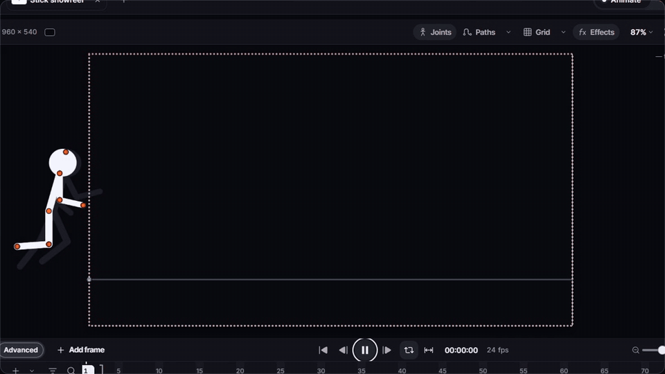
</p>

## Was ist Stick?

**Stick** ist eine Desktop- und Web-App für **Strichmännchen-Animation**. Du ziehst die Gelenke, um die Figur zu posen, fügst ein Bild hinzu, änderst die Pose, und Stick füllt die Bewegung dazwischen. Dazu kommen eine Zeitleiste mit Ebenen, Zwiebelschicht, Kamerafahrten, visuelle Effekte, Pinsel zum Zeichnen von Hand und ein Rig-Editor für eigene Figuren.

Stick öffnet Projekte aus **Pivot Animator** (`.piv`, `.stk`) und **Stick Nodes**, sodass du alte Animationen weiterbearbeiten kannst. Alles läuft auf deinem Rechner: kein Konto, kein Wasserzeichen, keine Uploads.

## Funktionen

<table>
<tr>
<td width="50%" valign="top">

### Jedes Gelenk posen
Hände und Füße ziehen; inverse Kinematik (IK) beugt Ellbogen und Knie für dich. Winkelsperre, dehnbare Knoten und 3D-Teile.

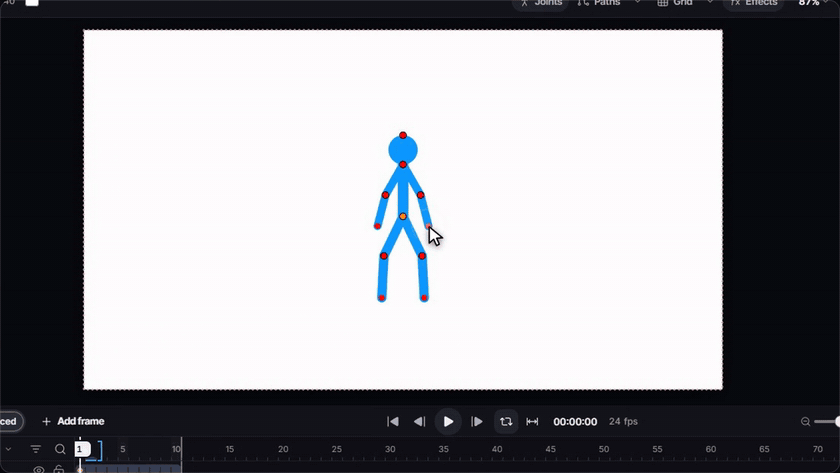

</td>
<td width="50%" valign="top">

### Keyframes und Wiedergabe
Bild hinzufügen, Pose ändern, abspielen. Zwischenbilder, Easing-Kurven und WebGPU-Wiedergabe in Echtzeit.

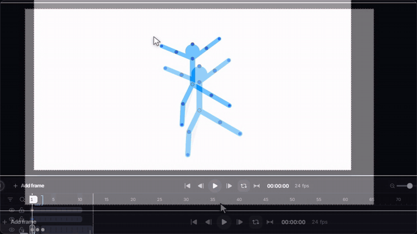

</td>
</tr>
<tr>
<td width="50%" valign="top">

### Eine echte Zeitleiste
Einfacher Bildstreifen oder erweiterte Zeitleiste mit Ebenen, Ordnern, Keys, Easing, Wiedergabebereichen, Zwiebelschicht und Audiospuren.

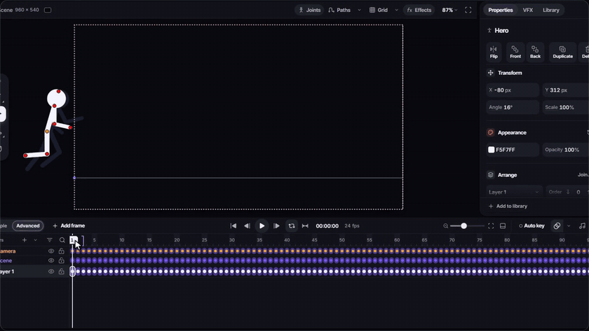

</td>
<td width="50%" valign="top">

### Eingebaute Effekte
Leuchten, Aura, Schatten, Weichzeichner, Partikel, Energiestrahlen, Explosionen, Rauch und Power-ups, pro Bild animierbar.

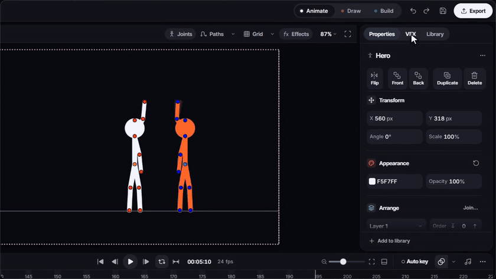

</td>
</tr>
<tr>
<td width="50%" valign="top">

### Auf jedes Bild zeichnen
Tinte, Pinselstift, Bleistift, Fineliner, Marker, Kohle, Airbrush, Kreide, Öl und mehr. Handzeichnung und Rigs frei mischen.

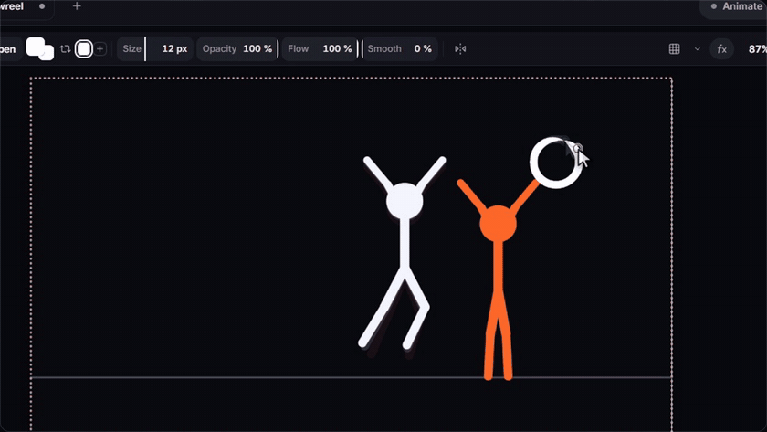

</td>
<td width="50%" valign="top">

### Eigene Rigs bauen
Figuren aus Linien, Kreisen, Polygonen, Text und Bildern bauen. Starte mit Beispielen wie Zahnrädern, Fächern, Kisten und 3D-Formen.

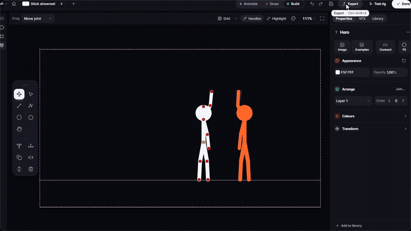

</td>
</tr>
<tr>
<td width="50%" valign="top">

### Jeder Befehl, eine Suche entfernt
Drücke <kbd>F1</kbd> oder <kbd>Strg</kbd>+<kbd>P</kbd>, um jeden Befehl zu finden. Alle Tastenkürzel lassen sich ändern.

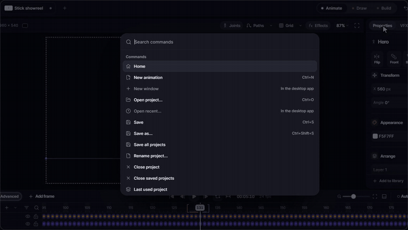

</td>
<td width="50%" valign="top">

### Hell oder dunkel, in 27 Sprachen
Standardmäßig dunkles Design, auf Wunsch hell, einstellbare UI-Größe und Touch-Layout für Tablets.

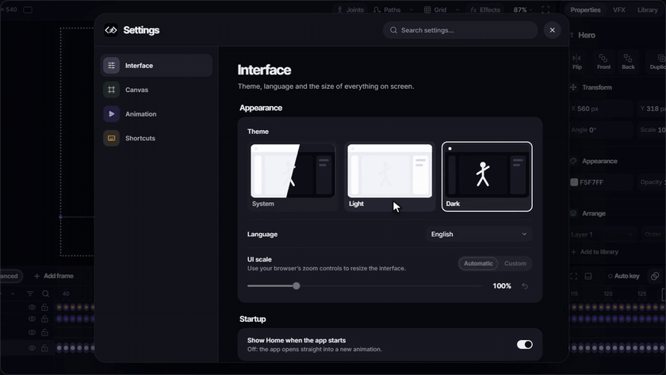

</td>
</tr>
</table>

### Überallhin exportieren

Ein-Klick-Vorlagen für **YouTube**, **YouTube Shorts**, **TikTok**, **Instagram Reels**, **X**, Chat-**GIFs**, transparente PNG-Bilder und 4K. Exportiere **MP4**, **WebM** (mit Transparenz), **GIF**, **APNG**, **PNG / JPEG / SVG**-Sequenzen oder bearbeitbare `.piv`- und `.stk`-Dateien.

<p align="center">
  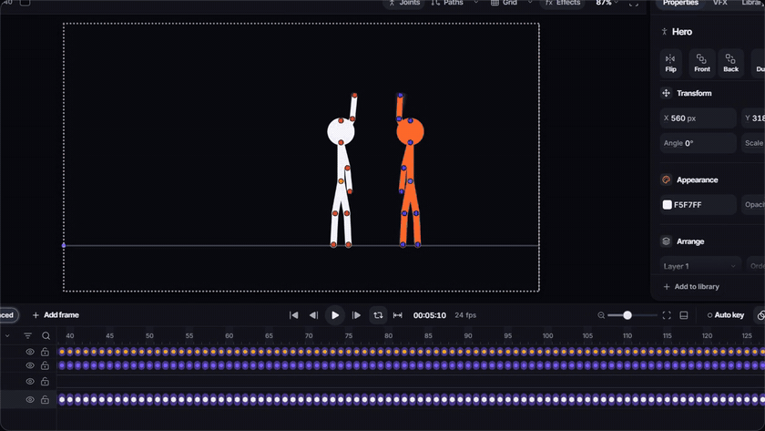
</p>

## Galerie

<table>
<tr>
<td>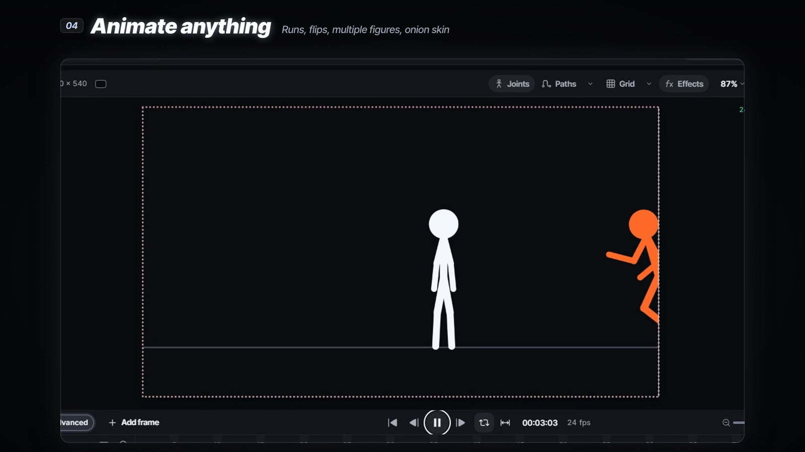</td>
<td>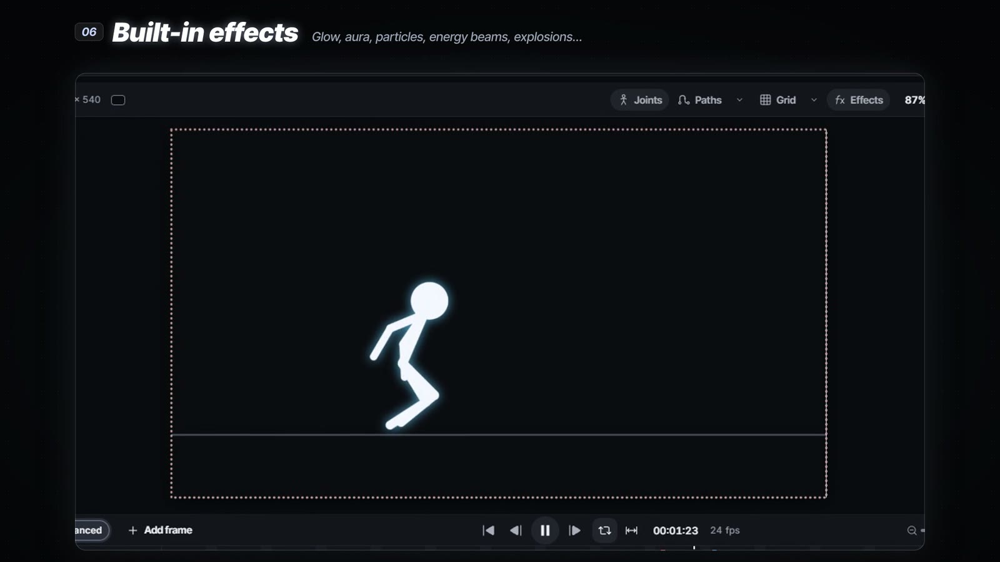</td>
</tr>
<tr>
<td>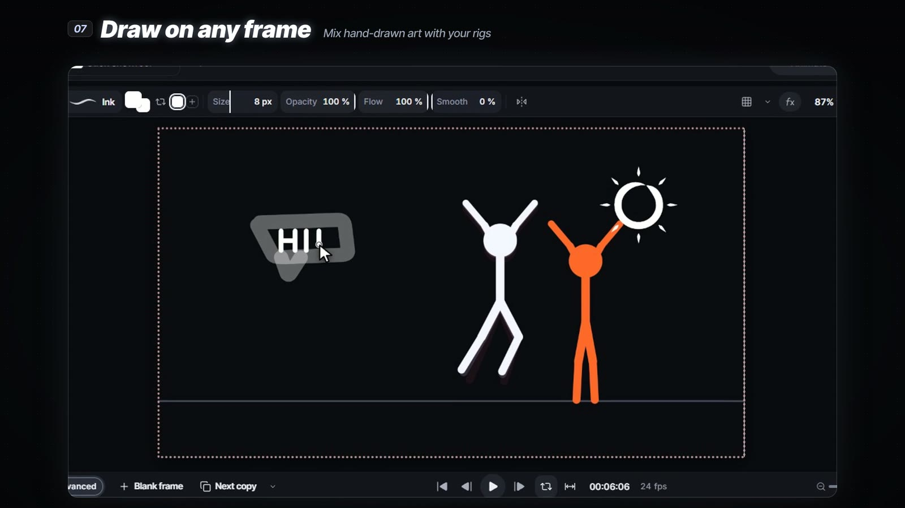</td>
<td>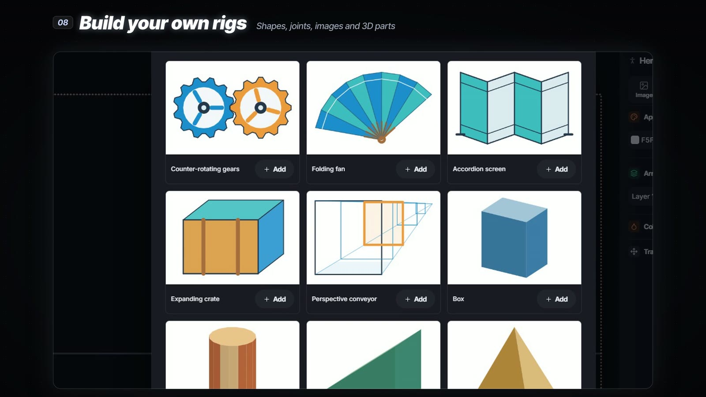</td>
</tr>
<tr>
<td>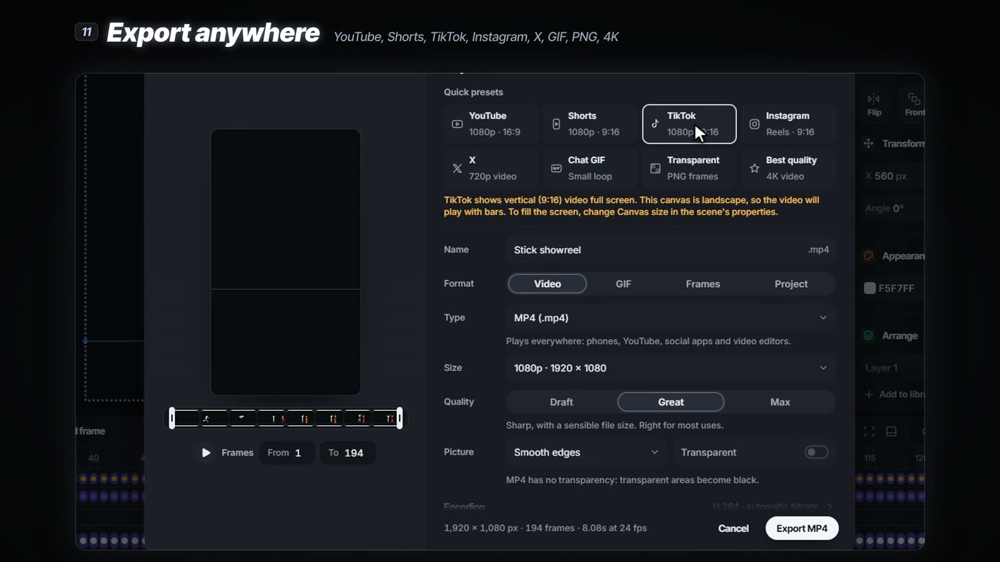</td>
<td>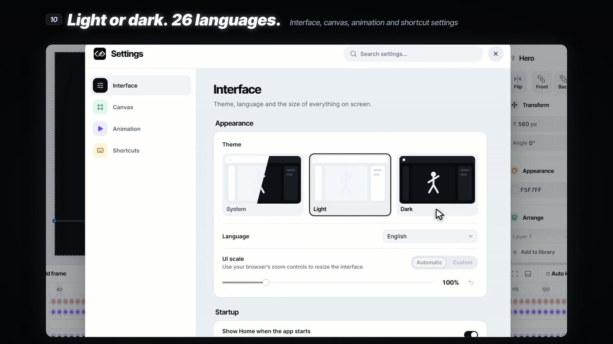</td>
</tr>
</table>

## Stick holen

- **Selbst bauen** mit wenigen Befehlen; siehe [Aus dem Quellcode bauen](#aus-dem-quellcode-bauen). Läuft als Desktop-App oder im Browser.
- **Installer:** Versionen für Windows (Setup und portabel) und Linux (AppImage) erscheinen auf der [Releases-Seite](https://github.com/blixvip/stick/releases). Klicke auf **Watch → Custom → Releases**, um benachrichtigt zu werden.
- **Erst ansehen:** die [2-Minuten-Video-Tour](https://blixvip.github.io/stick/#tour).

⭐ **Gib diesem Repository einen Stern**, um neue Versionen zu verfolgen und anderen Animatoren zu helfen, Stick zu finden.

## FAQ

<details>
<summary><b>Ist Stick kostenlos?</b></summary>

Ja. Stick ist kostenlos und Open Source unter der GPL-3.0-Lizenz. Kein Konto, kein Wasserzeichen, keine Bezahlversion.
</details>

<details>
<summary><b>Ist Stick eine Alternative zu Pivot Animator?</b></summary>

Ja. Stick öffnet Pivot-Animator-Projekte (<code>.piv</code>) und -Figuren (<code>.stk</code>) und kann sie wieder exportieren – mit Ebenen, Zwischenbildern, Effekten, Zeichnen und modernem WebGPU-Rendering.
</details>

<details>
<summary><b>Kann ich Stick-Nodes-Projekte am PC öffnen?</b></summary>

Ja. Stick importiert Stick-Nodes-Figuren, Movieclips und Projekte, damit du unter Windows oder Linux weiterarbeiten kannst.
</details>

<details>
<summary><b>Wie erstelle ich eine Strichmännchen-Animation?</b></summary>

Pose die Figur, indem du ihre Gelenke ziehst, drücke <b>Bild hinzufügen</b> (<kbd>A</kbd>), ändere die Pose und drücke <kbd>Leertaste</kbd> zum Abspielen. Stick berechnet die Bewegung dazwischen. Klicke dann auf <b>Exportieren</b> und wähle MP4, GIF oder eine Vorlage wie TikTok.
</details>

<details>
<summary><b>Funktioniert Stick offline? Lädt es meine Animationen hoch?</b></summary>

Stick funktioniert komplett offline. Deine Projekte bleiben auf deinem Rechner; nichts wird hochgeladen.
</details>

## Aus dem Quellcode bauen

Voraussetzungen: Node.js 22+ und Python 3.11+.

```sh
git clone https://github.com/blixvip/stick.git
cd stick
npm ci
python -m pip install -r backend/requirements-fast.txt
npm start            # Desktop-App (Electron)
npm run serve        # oder der Editor im Browser: http://127.0.0.1:47831
```

## Lizenz

Stick ist freie Software unter der [GNU General Public License v3.0](../../LICENSE) oder neuer. Es ist eine veränderte Version früherer GPL-lizenzierter Software (geändert im Oktober 2026); der vollständige Änderungsverlauf steht in diesem Repository. Stick ist ein unabhängiges Projekt und steht in keiner Verbindung zu Pivot Animator oder Stick Nodes; diese Namen beschreiben nur die Dateikompatibilität.

<p align="center">
  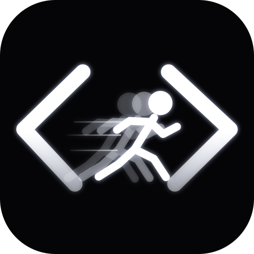<br>
  <sub><b>Stick</b> · Kostenlose Strichmännchen-Animationssoftware · Stickman-Animator für Windows, Linux und das Web</sub>
</p>
